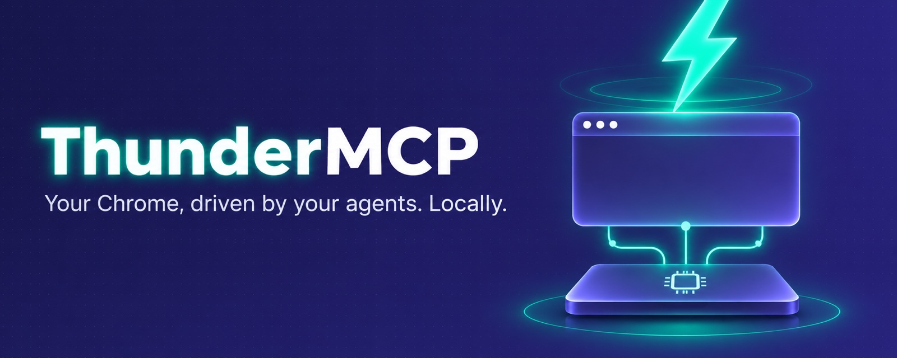
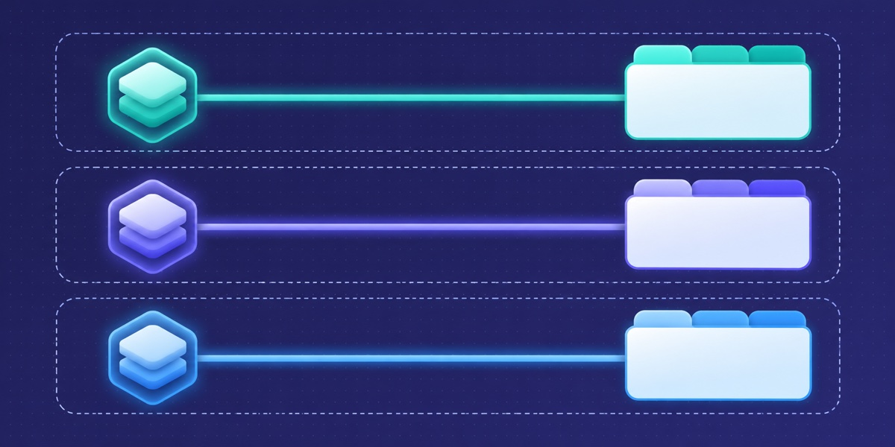
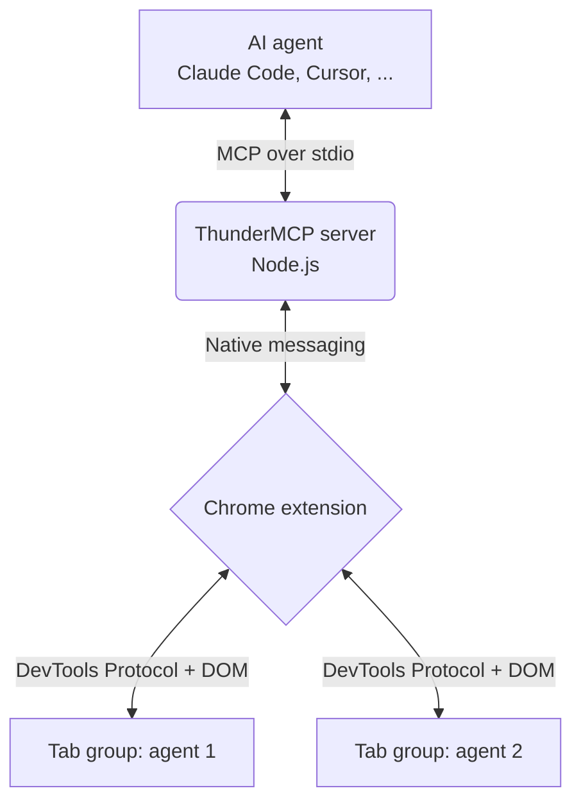
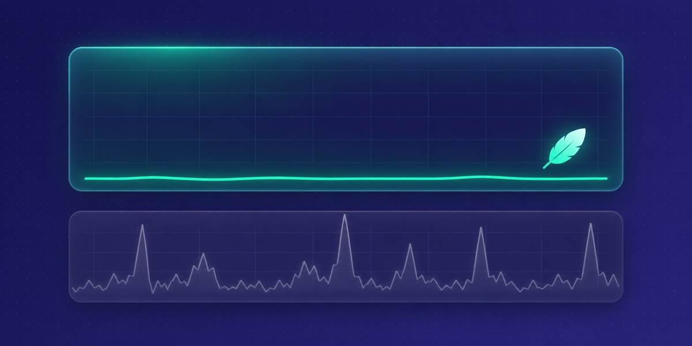

# ThunderMCP



> A fast, local Chrome MCP server for AI agents. Your browser, your logins, near-zero overhead.


ThunderMCP is a Chrome extension plus a small local MCP (Model Context Protocol) server. It lets any MCP-capable agent (Claude Code, Codex, Cursor and others) drive the Chrome you already use: click, type, read pages, take screenshots, run JavaScript and record GIFs, without a cloud VM or a headless browser.

<!-- DEMO VIDEO 1 -->
> **Demo 1: Bulk work in one shot.** An agent learns one form, then injects a script to submit it across many sites, stopping before every final submit.

<!-- DEMO VIDEO 2 -->
> **Demo 2: Parallel agents, multiple profiles.** Several agents work at once in their own tab groups, across two Chrome profiles (work and personal), with no cross-talk.

<!-- DEMO VIDEO 3 -->
> **Demo 3: Screenshots that don't melt your laptop.** Continuous screenshots next to Activity Monitor. Chrome scales the image itself; no in-page canvas re-encoding.

## Why ThunderMCP

Most browser automation for agents means a cloud VM, a heavy headless browser, or an extension that eats your CPU and takes over your session.

- **Local only.** No cloud, no accounts, no sidebar chat, no per-site permission popups. Your agent talks to your Chrome through a local process.
- **Familiar tool interface.** 16 of the 26 tools use the same names and arguments as the browser tools agents already know from Claude in Chrome, so existing prompts mostly carry over. The other 10 are ThunderMCP additions.
- **Small footprint.** Screenshots are scaled by Chrome itself through the DevTools Protocol. No in-page canvas work, no animated overlays.

## Features



- **Parallel agents without cross-talk.** Each agent session gets its own Chrome tab group and can only see and act on tabs inside it.
- **Multiple profiles.** Install the extension in several Chrome profiles. The agent sees each profile's name and signed-in email and can switch between them.
- **`quick_task` executor.** Hand over a route (each step plus what you expect to see) and a fast small model clicks through it, about 0.2–0.5 s per decision, handing control back when unsure. `stopBefore` hard-blocks named buttons such as "Submit" or "Pay". Needs a Typesafe or OpenRouter API key; every other tool works without one.
- **Token-efficient by default.** Agents read the accessibility tree and page text first and fall back to screenshots only when needed. For repetitive work they are steered toward one injected script that returns compact JSON.
- **Human in the loop.** Agents are told to stop before final submit, payment, send and delete, and to pause for you on real CAPTCHAs.
- **GIF recording.** Record a session as a GIF for sharing, debugging or review.

## Quick start

**Requirements:** macOS, Node.js 18+, Google Chrome.

1. **Install** (the MCP server is a single ~450 KB JS file):

   ```bash
   curl -fsSL https://github.com/214140846/thundermcp/releases/latest/download/install.sh | sh
   ```

   Files go to `~/.thundermcp`. Run with `--dry-run` to see what it would do, or `--uninstall` to remove it.

2. **Load the extension:** open `chrome://extensions`, turn on Developer mode, click "Load unpacked" and pick `~/.thundermcp/extension`.

3. **Connect your agent.** If the `claude` CLI is installed, the installer registers ThunderMCP with Claude Code for you. For other agents, add this to their MCP config (use the full path to your home directory; most clients do not expand `~`):

   ```json
   { "mcpServers": { "thundermcp": { "command": "node", "args": ["/Users/you/.thundermcp/thundermcp.mjs", "mcp"] } } }
   ```

**Build from source:** `bun install && bun run build && sh install.sh` (uses the local `dist/thundermcp.mjs` and `extension/`).

## How it works



## Tools

26 tools in total.

**Same names and arguments as Claude in Chrome (16):**
`tabs_context_mcp`, `tabs_create_mcp`, `tabs_close_mcp`, `read_page`, `get_page_text`, `find`, `computer`, `form_input`, `navigate`, `resize_window`, `javascript_tool`, `read_console_messages`, `read_network_requests`, `file_upload`, `upload_image`, `gif_creator`

**ThunderMCP additions (10):**

| Tool | What it does |
|---|---|
| `browser_batch` | Run several simple actions in one call. |
| `quick_find` / `quick_check` | Ask the fast model to locate an element or check a statement about the page. |
| `quick_task`, `quick_task_status`, `quick_task_result`, `quick_task_stop` | Run a known route with the fast executor in the background. |
| `list_connected_browsers`, `select_browser`, `switch_browser` | See every connected Chrome profile (name and email) and choose which one to drive. |

## Benchmarks

*Measured on a MacBook with a pre-release build, using a real e-commerce exchange flow (find order, pick item, choose new variant, review page, stop before submit).*

### CPU



| Scenario | Result |
|---|---|
| Another browser-agent extension, heavy news page (read + scroll + screenshot) | Chrome uses **+108%** CPU vs. idle (about one extra core) |
| ThunderMCP extension process, two agents on two profiles | **1.4%** average |
| ThunderMCP, full exchange flow | Chrome **4.9%** average |

### Cost and speed (same flow, same tools)
| Agent model | Time | Cost |
|---|---|---|
| Claude Opus | 112 s | $0.79 |
| Claude Haiku | 87–100 s | **$0.03–0.05** (about 4–5% of Opus) |

Text-first reads and script batching are what let a small model finish the whole flow.

### Parallel reliability
3 agents ran the full flow at the same time in one Chrome: all finished in **116–135 s**, with **0** actions on the wrong tab.

## FAQ

**Will my Claude in Chrome prompts work?** Mostly. The 16 shared tools take the same names and arguments; behaviour and output text are ThunderMCP's own.

**Does anything go to the cloud?** No. Agent, local MCP server, your Chrome. Only the `quick_*` tools call the small-model API you configure.

**Will it click "Pay" or "Submit" on its own?** Agents are instructed to stop before final submit, payment, send and delete, and `stopBefore` lets you hard-block named buttons in `quick_task`.

**CAPTCHAs?** It does not solve them. It pauses and asks you to.

**Linux / Windows?** macOS is tested. The installer also runs on Linux, but that path is experimental and untested. Windows is not supported.

## Contributing

PRs are welcome. See [CONTRIBUTING.md](CONTRIBUTING.md) for how to run the unit and end-to-end tests.

## License

MIT. See [LICENSE](LICENSE). Third-party components and their licenses are listed in [NOTICE](NOTICE).

---

*ThunderMCP is an independent open-source project. It is not affiliated with, endorsed by, or sponsored by Anthropic. Its tool interface is designed to match Claude in Chrome's browser tools for developer convenience only; it was written independently, and no Claude in Chrome source code was copied.*
