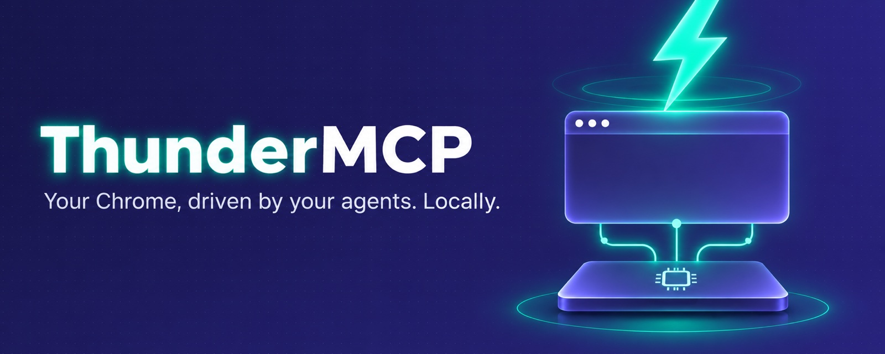
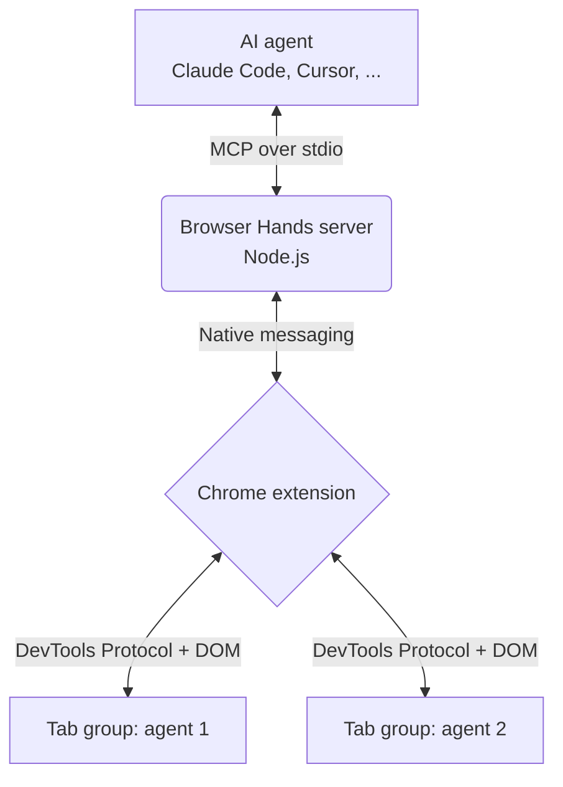
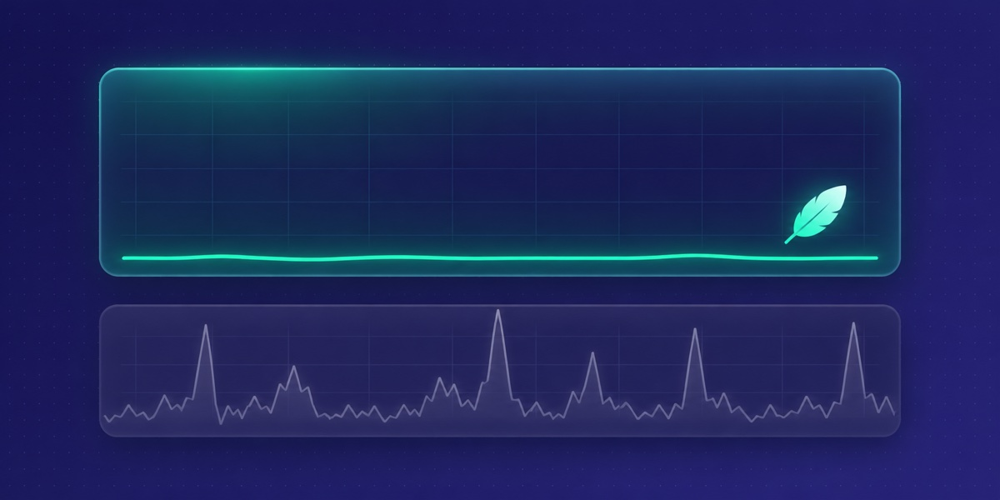

# Browser Hands



> A fast, local Chrome MCP server for AI agents. Your browser, your logins, near-zero overhead.


Browser Hands is a Chrome extension plus a small local MCP (Model Context Protocol) server. It lets any MCP-capable agent (Claude Code, Codex, Cursor and others) drive the Chrome you already use: click, type, read pages, take screenshots, run JavaScript and record GIFs, without a cloud VM or a headless browser.

**In one sentence:** if you want Claude Code, Cursor, Codex or another MCP client to control *your existing Chrome* (your tabs, your cookies, your logged-in accounts) instead of a fresh headless browser, this is what Browser Hands does. It is free and open source (MIT).

[](docs/media/demo.mp4)

*An agent filling in a Product Hunt launch form in my own logged-in Chrome (sped up, idle waits removed). [MP4](docs/media/demo.mp4)*

<!-- DEMO VIDEO 1 -->
> **Demo 1: Bulk work in one shot.** An agent learns one form, then injects a script to submit it across many sites, stopping before every final submit.

<!-- DEMO VIDEO 2 -->
> **Demo 2: Parallel agents, multiple profiles.** Several agents work at once in their own tab groups, across two Chrome profiles (work and personal), with no cross-talk.

<!-- DEMO VIDEO 3 -->
> **Demo 3: Screenshots that don't melt your laptop.** Continuous screenshots next to Activity Monitor. Chrome scales the image itself; no in-page canvas re-encoding.

## Why Browser Hands

Most browser automation for agents means a cloud VM, a heavy headless browser, or an extension that eats your CPU and takes over your session.

- **Local only.** No cloud, no accounts, no sidebar chat, no per-site permission popups. Your agent talks to your Chrome through a local process.
- **Familiar tool interface.** 16 of the 26 tools use the same names and arguments as the browser tools agents already know from Claude in Chrome, so existing prompts mostly carry over. The other 10 are Browser Hands additions.
- **Small footprint.** Screenshots are scaled by Chrome itself through the DevTools Protocol. No in-page canvas work, no animated overlays.

## Features


- **Parallel agents without cross-talk.** Each agent session gets its own Chrome tab group and can only see and act on tabs inside it.
- **Multiple profiles.** Install the extension in several Chrome profiles. The agent sees each profile's name and signed-in email and can switch between them.
- **`quick_task` executor.** Hand over a route (each step plus what you expect to see) and a fast small model clicks through it, about 0.2–0.5 s per decision, handing control back when unsure. `stopBefore` hard-blocks named buttons such as "Submit" or "Pay". Needs a Typesafe or OpenRouter API key; every other tool works without one.
- **Token-efficient by default.** Agents read the accessibility tree and page text first and fall back to screenshots only when needed. For repetitive work they are steered toward one injected script that returns compact JSON.
- **Human in the loop.** Agents are told to stop before final submit, payment, send and delete, and to pause for you on real CAPTCHAs.
- **GIF recording.** Record a session as a GIF for sharing, debugging or review.

## Quick start

**Requirements:** macOS, Node.js 18+, Google Chrome.

1. **Install** (the MCP server is a single ~450 KB JS file):

   ```bash
   curl -fsSL https://github.com/214140846/browser-hands/releases/latest/download/install.sh | sh
   ```

   Files go to `~/.thundermcp`. Run with `--dry-run` to see what it would do, or `--uninstall` to remove it.

2. **Load the extension:** open `chrome://extensions`, turn on Developer mode, click "Load unpacked" and pick `~/.thundermcp/extension`.

3. **Connect your agent.** If the `claude` CLI is installed, the installer registers Browser Hands with Claude Code for you. For other agents, add this to their MCP config (use the full path to your home directory; most clients do not expand `~`):

   ```json
   { "mcpServers": { "thundermcp": { "command": "node", "args": ["/Users/you/.thundermcp/thundermcp.mjs", "mcp"] } } }
   ```

**Build from source:** `bun install && bun run build && sh install.sh` (uses the local `dist/thundermcp.mjs` and `extension/`).

### Connect Claude Code

The installer runs `claude mcp add` for you when the `claude` CLI is on your PATH. To do it by hand:

```bash
claude mcp add thundermcp -s user -- node ~/.thundermcp/thundermcp.mjs mcp
```

Then ask Claude Code something like *"Open my GitHub notifications in Chrome and summarize them."*

### Connect Cursor

Add the server to `~/.cursor/mcp.json` (or `.cursor/mcp.json` in a project), then enable it in Cursor's MCP settings:

```json
{ "mcpServers": { "thundermcp": { "command": "node", "args": ["/Users/you/.thundermcp/thundermcp.mjs", "mcp"] } } }
```

### Connect Codex

Add the server to `~/.codex/config.toml`:

```toml
[mcp_servers.thundermcp]
command = "node"
args = ["/Users/you/.thundermcp/thundermcp.mjs", "mcp"]
```

Any other MCP client that can start a stdio server works the same way: command `node`, arguments `<path>/thundermcp.mjs mcp`.

## What you can do with it

- **Work in sites you are already logged into.** Gmail, GitHub, Notion, Jira, admin panels, internal tools: the agent uses the session that is already in your Chrome profile. You do not give it a password, and it does not need an API integration for each site.
- **Test your web app in a real browser.** Let your coding agent open `localhost`, click through the change it just made, read console errors (`read_console_messages`) and network requests (`read_network_requests`), and take screenshots to check the UI.
- **Fill in forms and repeat web chores.** `find`, `form_input`, `computer` (click, type, keys, scroll) and `file_upload` cover multi-step forms. For many similar items the agent can run one script with `javascript_tool`, or hand a known route to `quick_task`.
- **Read and inspect pages.** `read_page` returns the accessibility tree with element references, `get_page_text` returns the main text, `find` locates elements by description, and `javascript_tool` can query the DOM directly.
- **See the screen.** `computer` with `screenshot` or `zoom` gives the agent an image of the tab when text is not enough.
- **Run several tabs or agents at once.** Each agent session gets its own tab group, so parallel agents do not touch each other's tabs.

## How it compares

Browser Hands is one of several ways to give an agent a browser. The main difference is *which* browser the agent drives.

| | Browser Hands | A Playwright-style MCP server | A DevTools-port MCP server |
|---|---|---|---|
| Browser the agent drives | Your everyday Chrome, through an extension | Usually a separate browser it starts | A Chrome started with a remote debugging port |
| Your logins and cookies | Already there | Usually you log in again, or load saved state | Depends on which profile you start |
| Remote debugging port (`9222`) | Not needed | Not needed | Needed |
| Parallel agents isolated by tab group | Yes | — | — |

Pick a Playwright-style server when you want a clean, scripted, reproducible browser (for example in CI). Pick Browser Hands when the agent should work in the browser you actually use, with your accounts.

## How it works



## Tools

26 tools in total.

**Same names and arguments as Claude in Chrome (16):**
`tabs_context_mcp`, `tabs_create_mcp`, `tabs_close_mcp`, `read_page`, `get_page_text`, `find`, `computer`, `form_input`, `navigate`, `resize_window`, `javascript_tool`, `read_console_messages`, `read_network_requests`, `file_upload`, `upload_image`, `gif_creator`

**Browser Hands additions (10):**

| Tool | What it does |
|---|---|
| `browser_batch` | Run several simple actions in one call. |
| `quick_find` / `quick_check` | Ask the fast model to locate an element or check a statement about the page. |
| `quick_task`, `quick_task_status`, `quick_task_result`, `quick_task_stop` | Run a known route with the fast executor in the background. |
| `list_connected_browsers`, `select_browser`, `switch_browser` | See every connected Chrome profile (name and email) and choose which one to drive. |

## Benchmarks

*Measured on a MacBook with a pre-release build, using a real e-commerce exchange flow (find order, pick item, choose new variant, review page, stop before submit).*

### CPU



| Scenario | Result |
|---|---|
| Another browser-agent extension, heavy news page (read + scroll + screenshot) | Chrome uses **+108%** CPU vs. idle (about one extra core) |
| Browser Hands extension process, two agents on two profiles | **1.4%** average |
| Browser Hands, full exchange flow | Chrome **4.9%** average |

### Cost and speed (same flow, same tools)
| Agent model | Time | Cost |
|---|---|---|
| Claude Opus | 112 s | $0.79 |
| Claude Haiku | 87–100 s | **$0.03–0.05** (about 4–5% of Opus) |

Text-first reads and script batching are what let a small model finish the whole flow.

### Parallel reliability
3 agents ran the full flow at the same time in one Chrome: all finished in **116–135 s**, with **0** actions on the wrong tab.

## Troubleshooting

**The agent says no browser is connected.**
1. Open the Browser Hands popup in Chrome's toolbar. If it says *host not connected*, the native messaging host is not registered. Run `node ~/.thundermcp/thundermcp.mjs setup` again, then restart Chrome.
2. Check that the extension is loaded and enabled at `chrome://extensions`.
3. Ask the agent to call `list_connected_browsers`. It lists every Chrome profile that has the extension and is online.

**The agent does not show the Browser Hands tools.**
1. Run `claude mcp list` (Claude Code) or open your client's MCP settings, and check that `thundermcp` is listed and running.
2. Use the full path to `thundermcp.mjs` in the config. Most clients do not expand `~`.
3. Check that `node --version` prints 18 or later.

**Chrome shows a bar that says the extension started debugging this browser.** This is normal. Chrome shows it while an extension uses the DevTools Protocol, which Browser Hands uses for clicks, typing and screenshots.

**Two Chrome profiles are open and the agent uses the wrong one.** Ask it to call `list_connected_browsers` and then `select_browser` with the profile you want.

## FAQ

**Can Claude Code control my Chrome browser?**
Yes. Install Browser Hands, load the extension and register the MCP server (see [Quick start](#quick-start)). Claude Code can then open tabs, read pages, click, type, fill forms and take screenshots in your Chrome.

**Can AI agents use my logged-in browser sessions?**
Yes. The agent works inside your normal Chrome profile, so every site you are logged into is available to it. Browser Hands does not read or export your passwords. It acts in the page the same way you would.

**Does it open a new browser window or a headless browser?**
No headless browser. The agent works in the Chrome you already run. It opens its own tabs in a tab group, so your other tabs stay as they are.

**Does it work with Cursor, Codex or other agents?**
Yes, with any client that supports MCP stdio servers. See [Connect Cursor](#connect-cursor) and [Connect Codex](#connect-codex).

**Do I need Playwright or Puppeteer?**
No. The agent drives Chrome through the Browser Hands extension, not through Playwright or Puppeteer, and you do not write automation scripts. (The project's own end-to-end tests use Playwright, but you do not need it to use Browser Hands.)

**Can the agent see my screen?**
It can take a screenshot of a tab it controls (`computer` → `screenshot`). It cannot see other apps or your desktop.

**Can several agents use the same Chrome at the same time?**
Yes. Each agent session gets its own tab group and can only act on tabs inside it. In our test, 3 agents ran the same flow at once with 0 actions on the wrong tab (see [Benchmarks](#benchmarks)).

**Is it safe to let an agent control my Chrome?**
Treat it like giving a person your unlocked laptop: the agent can do what you can do in the pages it opens. Browser Hands limits the risk in these ways:
- Everything runs locally. No account and no Browser Hands cloud.
- Each agent only sees the tabs in its own tab group.
- Agents are told to stop and ask before final submit, payment, send and delete, and to hand CAPTCHAs to you.
- `quick_task` can hard-block named buttons with `stopBefore`.
- The popup lists active sessions and has a **Stop all** button.
- The code is open source, so you can read what it does.

These are instructions and limits, not a guarantee. Watch the agent on sites where a mistake is costly.

**Will my Claude in Chrome prompts work?** Mostly. The 16 shared tools take the same names and arguments; behaviour and output text are Browser Hands's own.

**Does anything go to the cloud?** No. Agent, local MCP server, your Chrome. Only the `quick_*` tools call the small-model API you configure.

**Will it click "Pay" or "Submit" on its own?** Agents are instructed to stop before final submit, payment, send and delete, and `stopBefore` lets you hard-block named buttons in `quick_task`.

**CAPTCHAs?** It does not solve them. It pauses and asks you to.

**Is it free and open source?** Yes. MIT license. The `quick_*` tools need your own Typesafe or OpenRouter API key. Every other tool is free to use.

**Linux / Windows?** macOS is tested. The installer also runs on Linux, but that path is experimental and untested. Windows is not supported.

**Other browsers?** Google Chrome 116 or later is the target. The installer also accepts `--browser chromium` and `--browser chrome-for-testing`. Edge, Brave, Arc, Firefox and Safari are not tested.

## Contributing

PRs are welcome. See [CONTRIBUTING.md](CONTRIBUTING.md) for how to run the unit and end-to-end tests.

## License

MIT. See [LICENSE](LICENSE). Third-party components and their licenses are listed in [NOTICE](NOTICE).

---

*Browser Hands is an independent open-source project. It is not affiliated with, endorsed by, or sponsored by Anthropic. Its tool interface is designed to match Claude in Chrome's browser tools for developer convenience only; it was written independently, and no Claude in Chrome source code was copied.*
