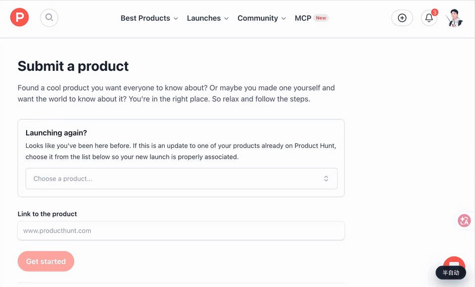
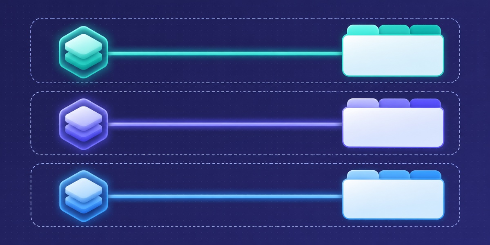
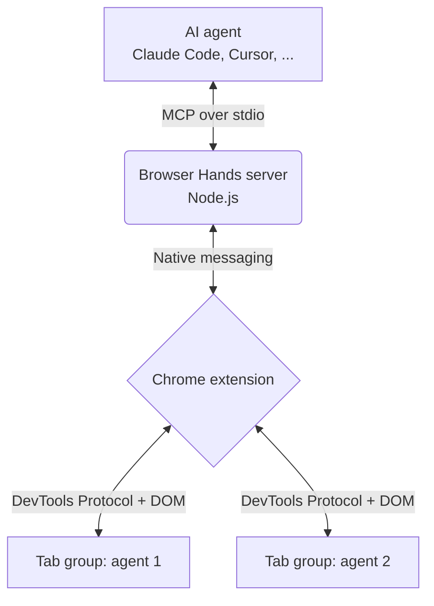

# Browser Hands


> A fast, local Chrome MCP server for AI agents. Your browser, your logins, near-zero overhead.


Browser Hands is a Chrome extension plus a small local MCP (Model Context Protocol) server. It lets any MCP-capable agent (Claude Code, Codex, Cursor and others) drive the Chrome you already use: click, type, read pages, take screenshots, run JavaScript and record GIFs, without a cloud VM or a headless browser.

**In one sentence:** if you want Claude Code, Cursor, Codex or another MCP client to control *your existing Chrome* (your tabs, your cookies, your logged-in accounts) instead of a fresh headless browser, this is what Browser Hands does. It is free and open source (MIT).

**Jump to:** [Quick start](#quick-start) · [Problems it solves](#problems-it-solves) · [What people use it for](#what-people-use-it-for) · [When the obvious tool gets in the way](#when-the-obvious-tool-gets-in-the-way) · [What it does not do](#what-it-does-not-do) · [Troubleshooting](#troubleshooting) · [FAQ](#faq)

[](docs/media/demo.mp4)

*An agent filling in a Product Hunt launch form in my own logged-in Chrome (sped up, idle waits removed). [MP4](docs/media/demo.mp4)*

<!-- DEMO VIDEO 1 -->
> **Demo 1: Bulk work in one shot.** An agent learns one form, then injects a script to submit it across many sites, stopping before every final submit.

<!-- DEMO VIDEO 2 -->
> **Demo 2: Parallel agents, multiple profiles.** Several agents work at once in their own tab groups, across two Chrome profiles (work and personal), with no cross-talk.

<!-- DEMO VIDEO 3 -->
> **Demo 3: Screenshots that don't melt your laptop.** Continuous screenshots next to Activity Monitor. Chrome scales the image itself; no in-page canvas re-encoding.

## Why Browser Hands

Most browser automation for agents means a cloud VM, a heavy headless browser, or an extension that eats your CPU and takes over your session.

- **Local only.** No cloud, no accounts, no sidebar chat, no per-site permission popups. Your agent talks to your Chrome through a local process.
- **Familiar tool interface.** 16 of the 26 tools use the same names and arguments as the browser tools agents already know from Claude in Chrome, so existing prompts mostly carry over. The other 10 are Browser Hands additions.
- **Small footprint.** Screenshots are scaled by Chrome itself through the DevTools Protocol. No in-page canvas work, no animated overlays.

## Problems it solves

These are the complaints we see most often in GitHub issues, Reddit and Hacker News threads about AI browser tools. Each row says what Browser Hands does about it.

### Connection and accounts

| You hit this | What Browser Hands does |
|---|---|
| "Browser extension is not connected" even though you are signed in | There is nothing to sign in to. The extension talks to a local process through Chrome native messaging. |
| You have several Claude accounts or organizations, and after you switch, the browser extension stays tied to the old one or stops connecting | Browser Hands has no account and no organization. Switching your Claude account, org or plan does not change the browser connection. |
| The extension signs you out every time Chrome restarts, so unattended tasks break | No sign-in to lose. |
| The browser integration only works with one agent, or not with API-key / Bedrock / Vertex setups | Any MCP client that can start a stdio server works: Claude Code (any login method), Cursor, Codex and others. |
| You must start Chrome with a remote debugging port, or newer Chrome refuses CDP on your default profile | No debugging port. The extension uses Chrome's `debugger` API inside your normal profile. |
| Your agent opens a fresh browser, so you are logged out of everything | The agent works in the Chrome you already use, with your cookies and sessions. |
| A built-in or sandboxed browser breaks SSO, password managers or other extensions | It is your real Chrome, so your SSO, password manager and extensions are all there. |

### Permissions and prompts

| You hit this | What Browser Hands does |
|---|---|
| A permission prompt on every site, or on every action, even after "Always allow" | No per-site or per-action prompts. You decide what the agent may do in your instructions. |
| `localhost`, banking or ERP sites are blocked by the tool | Browser Hands has no site blocklist. The agent can open any page your Chrome can open (Chrome itself still protects `chrome://` pages). |
| A "connect" popup every time the agent starts | You only see a popup when the agent calls `switch_browser`, to choose which Chrome profile it should use. |

### Several agents, tabs and profiles

| You hit this | What Browser Hands does |
|---|---|
| Two agent sessions fight over the same browser or the same tabs | Each MCP session gets its own tab group and can only act on tabs inside it. |
| Parallel sub-agents click over each other | Same isolation: one tab group per session. In our test, 3 agents ran at once with 0 actions on the wrong tab. |
| You use one Chrome profile per client or per account, and the agent picks the wrong one | `list_connected_browsers` shows every connected profile with its name and signed-in email. `select_browser` picks one. |
| The tool can only use one tab, or loses track after a new tab opens | `tabs_context_mcp` lists the session's tabs. The agent can create, switch and close tabs by ID. |
| The agent steals window focus or needs Chrome in front | Clicks and typing work in background tabs and minimized windows, without bringing Chrome to the front. |

### Speed, CPU and tokens

| You hit this | What Browser Hands does |
|---|---|
| Screenshots pile up and burn your context or usage limit | Agents are told to read the page as text first (`read_page`, `get_page_text`, `find`) and use screenshots only when text is not enough. |
| One page dumps tens of thousands of tokens | `read_page` takes `filter: "interactive"`, `ref_id`, `depth` and `max_chars`. `get_page_text` takes `max_chars`. |
| Every step is a separate slow tool call | `browser_batch` runs several actions in one call. For many similar items the agent can run one script with `javascript_tool`, or hand a known route to the fast `quick_task` executor. |
| The extension makes Chrome slow | Measured at 1.4% average CPU for the extension process with two agents (see [Benchmarks](#benchmarks)). |

### Hard pages

| You hit this | What Browser Hands does |
|---|---|
| The agent can click inside an iframe but cannot type, or cannot see iframe content | `read_page` scans every frame, including cross-origin iframes. Element refs carry a frame prefix (for example `f2:ref_5`) and work with `computer` and `form_input`. |
| File upload fails or is refused | `file_upload` takes absolute paths of files on your machine, or inline content. Large files are streamed in pieces. |
| The agent cannot see why the page broke | `read_console_messages` and `read_network_requests` give it the console log and network requests of the tab. |
| You cannot see what the agent actually did | `gif_creator` records the session as a GIF. The popup lists every active session and its tabs. |

## What people use it for

Real jobs people ask AI agents to do in a browser, grouped by who asks.

### Developers and QA

- **Check a change on `localhost` after each edit.** *"Open http://localhost:3000, sign up with a test user and tell me what breaks."*
- **Debug with the console and network log.** *"Reload the checkout page, read the console errors and the failed requests, then fix the code."*
- **Test a logged-in app without building an auth setup.** The agent uses the session already in your Chrome.
- **Compare the UI with a design.** Screenshots (`computer` → `screenshot` / `zoom`) let the agent look at the result.
- **Do the web-console setup steps it used to ask you to do.** Create a Stripe product, copy an API key, set a webhook URL, change a DNS record, in dashboards you are already logged into.
- **Inspect the DOM and accessibility tree** to write selectors, docs or schema.
- **Record a GIF of a bug** to attach to an issue.

### Founders and marketers

- **Submit a product to many directories.** The agent learns one form, then fills the others, and stops before each final submit.
- **Draft social posts on Reddit, X or LinkedIn** in your own logged-in accounts, and leave the final "Post" click to you.
- **Update WordPress or CMS settings** through the admin UI.
- **Research competitors** across many sites and tabs, including review sites, and collect the results.

### Sales and CRM

- **Clean or update CRM records** (HubSpot, Salesforce and similar) through the web UI when there is no API or no API access.
- **Prepare prospect briefs** from company sites and profiles you can already see when logged in.
- **Enter rows from a CSV into a web form**, one by one.

### E-commerce and operations

- **Bulk-edit listings** in Shopify admin or a marketplace seller dashboard: prices, fields, stock.
- **Read numbers from internal dashboards** that have no API, and summarize them.
- **Work in two accounts at once** by giving each Chrome profile its own agent.

### Finance and personal admin

- **Download statements and invoices** from portals you are logged into.
- **Fill in long government or application forms**, with you reviewing before submit.
- **Compare prices** across shops in parallel tabs.

## When the obvious tool gets in the way

The jobs above, combined with the problem that usually blocks them.

**"I want my agent to test my logged-in dashboard, but the test browser is always logged out."**
Browser Hands drives your own Chrome profile, so the agent starts already logged in. Nothing to export or configure.

**"I have two Claude accounts (work and personal). Every time I switch org, the browser extension stops connecting."**
Browser Hands does not use your Claude account at all. Switch accounts or orgs in Claude Code as often as you like. The browser connection stays the same.

**"I want three agents working at the same time, but they keep grabbing each other's tabs."**
Each agent session gets its own Chrome tab group and cannot act outside it. Start the three sessions and let them run.

**"I want the agent to work for client A and client B, but each client uses a different Chrome profile and Google account."**
Install the extension in both profiles. The agent calls `list_connected_browsers`, sees both profiles with their emails, and uses `select_browser` for the right one.

**"I want my coding agent to debug a failed API call, but it can't see the browser's network traffic."**
`read_network_requests` returns the tab's requests, and `read_console_messages` returns the console log, in the same Chrome where you reproduce the bug.

**"I want to verify UI changes on localhost, but my browser tool blocks localhost."**
There is no site blocklist. `localhost` and `127.0.0.1` work like any other page.

**"I want to automate Gmail or Notion, but I don't want to give the agent my password or an API token."**
You don't. The agent uses the session that is already open in your Chrome. Browser Hands never asks for or stores passwords.

**"I want to bulk-update 130 listings in a web app with no API, but the agent is slow and burns tokens."**
Let the agent learn one listing, then run one `javascript_tool` script over the rest, or hand a fixed route to `quick_task`. Text-first reading keeps each step small.

**"I want the agent to fill a form inside an embedded app or iframe, but typing goes nowhere."**
Refs from `read_page` cover cross-origin iframes, and `form_input` / `computer` type into the right frame.

**"I want to post on Reddit, X or LinkedIn from my own account, but I don't want the agent to press Post by itself."**
Agents are instructed to stop before final submit and send. With `quick_task`, `stopBefore` hard-blocks named buttons such as "Post".

**"I want to keep working while the agent runs, but it keeps pulling Chrome to the front."**
Clicks and typing work in background tabs and minimized windows.

**"I want the agent to upload a document, but file inputs fail."**
Give `file_upload` the absolute path of the file on your machine.

## What it does not do

To save you time, here is what Browser Hands does not cover today:

- **Windows and WSL** are not supported. Linux is experimental.
- **Brave, Edge, Vivaldi** are not tested. Google Chrome 116+ is the target; Arc on macOS is supported (see below).
- **Locked-down Chrome** where Developer mode is disabled by policy: the extension is loaded unpacked, so it needs Developer mode.
- **CAPTCHAs and anti-bot checks** are not solved or bypassed. The agent pauses and asks you.
- **`alert` / `confirm` dialogs** are not answered automatically. Only "leave page?" prompts are handled during navigation.
- **Scheduling** is not built in. Use your agent client or cron to start a session.
- **A browser on another machine** (remote server, SSH) cannot be controlled. The MCP server and Chrome must be on the same computer.
- **Generating Playwright test code**, performance traces and Electron apps are out of scope.

## Features



- **Parallel agents without cross-talk.** Each agent session gets its own Chrome tab group and can only see and act on tabs inside it.
- **Multiple profiles.** Install the extension in several Chrome profiles. The agent sees each profile's name and signed-in email and can switch between them.
- **`quick_task` executor.** Hand over a route (each step plus what you expect to see) and a fast small model clicks through it, about 0.2–0.5 s per decision, handing control back when unsure. `stopBefore` hard-blocks named buttons such as "Submit" or "Pay". Needs a Typesafe or OpenRouter API key; every other tool works without one.
- **Token-efficient by default.** Agents read the accessibility tree and page text first and fall back to screenshots only when needed. For repetitive work they are steered toward one injected script that returns compact JSON.
- **Human in the loop.** Agents are told to stop before final submit, payment, send and delete, and to pause for you on real CAPTCHAs.
- **GIF recording.** Record a session as a GIF for sharing, debugging or review.

## Quick start

**Requirements:** macOS, Node.js 18+, Google Chrome.

1. **Install** (the MCP server is a single ~450 KB JS file):

   ```bash
   curl -fsSL https://github.com/214140846/browser-hands/releases/latest/download/install.sh | sh
   ```

   Files go to `~/.thundermcp`. Run with `--dry-run` to see what it would do, or `--uninstall` to remove it.

2. **Load the extension:** open `chrome://extensions`, turn on Developer mode, click "Load unpacked" and pick `~/.thundermcp/extension`.

3. **Connect your agent.** If the `claude` CLI is installed, the installer registers Browser Hands with Claude Code for you. For other agents, add this to their MCP config (use the full path to your home directory; most clients do not expand `~`):

   ```json
   { "mcpServers": { "thundermcp": { "command": "node", "args": ["/Users/you/.thundermcp/thundermcp.mjs", "mcp"] } } }
   ```

**Build from source:** `bun install && bun run build && sh install.sh` (uses the local `dist/thundermcp.mjs` and `extension/`).

### Connect Claude Code

The installer runs `claude mcp add` for you when the `claude` CLI is on your PATH. To do it by hand:

```bash
claude mcp add thundermcp -s user -- node ~/.thundermcp/thundermcp.mjs mcp
```

Then ask Claude Code something like *"Open my GitHub notifications in Chrome and summarize them."*

### Connect Cursor

Add the server to `~/.cursor/mcp.json` (or `.cursor/mcp.json` in a project), then enable it in Cursor's MCP settings:

```json
{ "mcpServers": { "thundermcp": { "command": "node", "args": ["/Users/you/.thundermcp/thundermcp.mjs", "mcp"] } } }
```

### Connect Codex

Add the server to `~/.codex/config.toml`:

```toml
[mcp_servers.thundermcp]
command = "node"
args = ["/Users/you/.thundermcp/thundermcp.mjs", "mcp"]
```

Any other MCP client that can start a stdio server works the same way: command `node`, arguments `<path>/thundermcp.mjs mcp`.

## Tools in practice

- **Work in sites you are already logged into.** Gmail, GitHub, Notion, Jira, admin panels, internal tools: the agent uses the session that is already in your Chrome profile. You do not give it a password, and it does not need an API integration for each site.
- **Test your web app in a real browser.** Let your coding agent open `localhost`, click through the change it just made, read console errors (`read_console_messages`) and network requests (`read_network_requests`), and take screenshots to check the UI.
- **Fill in forms and repeat web chores.** `find`, `form_input`, `computer` (click, type, keys, scroll) and `file_upload` cover multi-step forms. For many similar items the agent can run one script with `javascript_tool`, or hand a known route to `quick_task`.
- **Read and inspect pages.** `read_page` returns the accessibility tree with element references, `get_page_text` returns the main text, `find` locates elements by description, and `javascript_tool` can query the DOM directly.
- **See the screen.** `computer` with `screenshot` or `zoom` gives the agent an image of the tab when text is not enough.
- **Run several tabs or agents at once.** Each agent session gets its own tab group, so parallel agents do not touch each other's tabs.

## How it compares

Browser Hands is one of several ways to give an agent a browser. Other common options are Playwright MCP and Chrome DevTools MCP. Their default setup starts or attaches to a browser for automation. Both projects also document ways to connect to an existing Chrome, so check their current docs if that is what you need.

What Browser Hands gives you:

| | Browser Hands |
|---|---|
| Browser the agent drives | Your everyday Chrome, through an extension |
| Your logins and cookies | Already there, from your normal profile |
| Remote debugging port (`9222`) | Not needed |
| Parallel agents | Each session gets its own tab group and cannot act on other tabs |
| Several Chrome profiles | `list_connected_browsers` / `select_browser` |
| Tool names | 16 tools match Claude in Chrome's names and arguments |

Pick a Playwright-style setup when you want a clean, scripted, reproducible browser (for example in CI). Pick Browser Hands when the agent should work in the browser you actually use, with your accounts, and several agents may run at once.

## How it works



## Tools

26 tools in total.

**Same names and arguments as Claude in Chrome (16):**
`tabs_context_mcp`, `tabs_create_mcp`, `tabs_close_mcp`, `read_page`, `get_page_text`, `find`, `computer`, `form_input`, `navigate`, `resize_window`, `javascript_tool`, `read_console_messages`, `read_network_requests`, `file_upload`, `upload_image`, `gif_creator`

**Browser Hands additions (10):**

| Tool | What it does |
|---|---|
| `browser_batch` | Run several simple actions in one call. |
| `quick_find` / `quick_check` | Ask the fast model to locate an element or check a statement about the page. |
| `quick_task`, `quick_task_status`, `quick_task_result`, `quick_task_stop` | Run a known route with the fast executor in the background. |
| `list_connected_browsers`, `select_browser`, `switch_browser` | See every connected Chrome profile (name and email) and choose which one to drive. |

## Benchmarks

*Measured on a MacBook with a pre-release build, using a real e-commerce exchange flow (find order, pick item, choose new variant, review page, stop before submit).*

### CPU


| Scenario | Result |
|---|---|
| Another browser-agent extension, heavy news page (read + scroll + screenshot) | Chrome uses **+108%** CPU vs. idle (about one extra core) |
| Browser Hands extension process, two agents on two profiles | **1.4%** average |
| Browser Hands, full exchange flow | Chrome **4.9%** average |

### Cost and speed (same flow, same tools)
| Agent model | Time | Cost |
|---|---|---|
| Claude Opus | 112 s | $0.79 |
| Claude Haiku | 87–100 s | **$0.03–0.05** (about 4–5% of Opus) |

Text-first reads and script batching are what let a small model finish the whole flow.

### Parallel reliability
3 agents ran the full flow at the same time in one Chrome: all finished in **116–135 s**, with **0** actions on the wrong tab.

## Troubleshooting

**The agent says no browser is connected.**
1. Open the Browser Hands popup in Chrome's toolbar. If it says *host not connected*, the native messaging host is not registered. Run `node ~/.thundermcp/thundermcp.mjs setup` again, then restart Chrome.
2. Check that the extension is loaded and enabled at `chrome://extensions`.
3. Ask the agent to call `list_connected_browsers`. It lists every Chrome profile that has the extension and is online.

**The agent does not show the Browser Hands tools.**
1. Run `claude mcp list` (Claude Code) or open your client's MCP settings, and check that `thundermcp` is listed and running.
2. Use the full path to `thundermcp.mjs` in the config. Most clients do not expand `~`.
3. Check that `node --version` prints 18 or later.

**Chrome shows a bar that says the extension started debugging this browser.** This is normal. Chrome shows it while an extension uses the DevTools Protocol, which Browser Hands uses for clicks, typing and screenshots.

**Two Chrome profiles are open and the agent uses the wrong one.** Ask it to call `list_connected_browsers` and then `select_browser` with the profile you want.

## FAQ

**Can Claude Code control my Chrome browser?**
Yes. Install Browser Hands, load the extension and register the MCP server (see [Quick start](#quick-start)). Claude Code can then open tabs, read pages, click, type, fill forms and take screenshots in your Chrome.

**Can AI agents use my logged-in browser sessions?**
Yes. The agent works inside your normal Chrome profile, so every site you are logged into is available to it. Browser Hands does not read or export your passwords. It acts in the page the same way you would.

**Does it open a new browser window or a headless browser?**
No headless browser. The agent works in the Chrome you already run. It opens its own tabs in a tab group, so your other tabs stay as they are.

**Does it work with Cursor, Codex or other agents?**
Yes, with any client that supports MCP stdio servers. See [Connect Cursor](#connect-cursor) and [Connect Codex](#connect-codex).

**Do I need Playwright or Puppeteer?**
No. The agent drives Chrome through the Browser Hands extension, not through Playwright or Puppeteer, and you do not write automation scripts. (The project's own end-to-end tests use Playwright, but you do not need it to use Browser Hands.)

**Can the agent see my screen?**
It can take a screenshot of a tab it controls (`computer` → `screenshot`). It cannot see other apps or your desktop.

**Can several agents use the same Chrome at the same time?**
Yes. Each agent session gets its own tab group and can only act on tabs inside it. In our test, 3 agents ran the same flow at once with 0 actions on the wrong tab (see [Benchmarks](#benchmarks)).

**Is it safe to let an agent control my Chrome?**
Treat it like giving a person your unlocked laptop: the agent can do what you can do in the pages it opens. Browser Hands limits the risk in these ways:
- Everything runs locally. No account and no Browser Hands cloud.
- The MCP server and the extension talk through Chrome native messaging and a local Unix socket in a folder only your user can read. There is no network port, so other web pages cannot reach it.
- Each agent only sees the tabs in its own tab group.
- Agents are told to stop and ask before final submit, payment, send and delete, and to hand CAPTCHAs to you.
- `quick_task` can hard-block named buttons with `stopBefore`.
- The popup lists active sessions and has a **Stop all** button.
- The code is open source, so you can read what it does.

These are instructions and limits, not a guarantee. Watch the agent on sites where a mistake is costly.

**Will my Claude in Chrome prompts work?** Mostly. The 16 shared tools take the same names and arguments; behaviour and output text are Browser Hands's own.

**Does anything go to the cloud?** No. Agent, local MCP server, your Chrome. Only the `quick_*` tools call the small-model API you configure.

**Will it click "Pay" or "Submit" on its own?** Agents are instructed to stop before final submit, payment, send and delete, and `stopBefore` lets you hard-block named buttons in `quick_task`.

**CAPTCHAs?** It does not solve them. It pauses and asks you to.

**Is it free and open source?** Yes. MIT license. The `quick_*` tools need your own Typesafe or OpenRouter API key. Every other tool is free to use.

**Linux / Windows?** macOS is tested. The installer also runs on Linux, but that path is experimental and untested. Windows is not supported.

**Other browsers?** Google Chrome 116 or later is the target. The installer also accepts `--browser chromium`, `--browser chrome-for-testing` and `--browser arc`. Edge, Brave, Firefox and Safari are not tested.

**Arc (macOS)?** Run `bun run setup --browser arc` and load the extension from `arc://extensions`. Arc reads native host manifests from Chrome's directory (not from `Arc/User Data`), so the manifest goes there and is shared with Chrome. Arc has the tab-groups API but `chrome.tabs.group` never returns, so when the host sees it was launched by Arc, each session tracks its own tab ids instead of using a tab group. Sessions stay isolated; you just don't see a colored group in the sidebar. Arc's DevTools screenshot also returns no data when asked to downscale, so on Arc screenshots are captured at full size and downscaled inside the extension.

**Arc profiles and spaces.** Load the extension once per Arc profile; each profile shows up as its own browser in `list_connected_browsers`. Spaces that share a profile share one copy of the extension. Arc puts a tab an extension opens into the space the window is showing at that moment, whatever profile asked for it, and the extension APIs cannot pick a space (tested: `openerTabId` and `index` make no difference; `chrome.windows.create` pops up a separate window). So keep at least one Arc window showing a space of the profile the agent works in. If every window shows another profile's space, the agent's tabs still use the right profile's cookies but appear in that other space's sidebar.

## Contributing

PRs are welcome. See [CONTRIBUTING.md](CONTRIBUTING.md) for how to run the unit and end-to-end tests.

## License

MIT. See [LICENSE](LICENSE). Third-party components and their licenses are listed in [NOTICE](NOTICE).

---

*Browser Hands is an independent open-source project. It is not affiliated with, endorsed by, or sponsored by Anthropic. Its tool interface is designed to match Claude in Chrome's browser tools for developer convenience only; it was written independently, and no Claude in Chrome source code was copied.*
